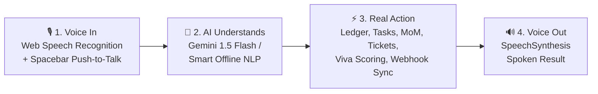

# 🎙️ VoxAction AI — Speak. Understand. Act.
> **An Autonomous Voice-to-Action Operating System** built for the **Voice AI Hackathon (6 Hours, College Hackathon)**.

[](https://github.com)
[](https://github.com)
[](https://github.com)
[](LICENSE)

---

## 📌 Problem & Hackathon Challenge

The core rule of the hackathon:
> *"Build an AI that listens to a voice, understands what the person needs, and does something real about it. Chat alone is not enough — the app must create, update, send, or control."*

Most voice assistants are merely chat interfaces. When users have fast-paced thoughts, capturing them requires opening multiple apps (expense tracker, reminders, helpdesk portal, meeting notes, email client). 

**VoxAction AI v2.0** solves this by converting compound, multi-intent voice commands in English, Hindi, and Hinglish into **immediate visible actions across multiple problem tracks in real time**.

---

## 🚀 4 Supported Problem Tracks (Slide 3)

| Track | Mode | Capability & Spoken Command Example |
| :--- | :--- | :--- |
| **Track 1: Voice to Action** | **⚡ Executive OS** | *"Spent 250 rupees on lunch and remind me to submit the form on Friday."* <br/>Logs ₹250 to expense ledger, schedules reminder, speaks confirmation. |
| **Track 1: Voice to Action** | **🎙️ Meeting to MoM** | *"Meeting with Design Team: Rahul will build login API by Friday, Priya will finalize Figma by Wednesday, and notify HOD."* <br/>Extracts action items, owners, deadlines, and drafts Minutes of Meeting email. |
| **Track 2: Real World** | **🚨 Emergency Triage** | *"Emergency, student fainted and having severe chest pain in block C lab 2!"* <br/>Triggers Code Red alert, sounds siren, files critical ticket, speaks first-aid instructions. |
| **Track 4: Learning** | **🎓 AI Viva Trainer** | AI asks computer science/engineering questions, student speaks answer into mic, AI scores response (1-10) with strengths and constructive feedback. |

---

## 🔄 The 4-Step Mandatory Pipeline



### 1. Voice In (Speech-to-Text)
- Browser-native **Web Speech API** (`webkitSpeechRecognition`) with zero latency.
- Real-time reactive **HTML5 Canvas audio frequency waveform** and glowing Siri-style pulse orb.
- **Spacebar Push-to-Talk**: Hold Spacebar to speak like a walkie-talkie!
- Multilingual support: **English (India)**, **English (US)**, and **Hindi (हिन्दी)** / Hinglish.

### 2. AI Understands (Intent Extraction & Planning)
- **Compound Multi-Intent Parser**: One spoken sentence can trigger 3 distinct actions across different modules at once.
- **Dual-Engine Brain**:
  - **Google Gemini API** (`gemini-1.5-flash` / `gemini-2.0-flash`) via structured JSON schema.
  - **Smart Built-in Offline NLP Parser**: 100% functional even if Wi-Fi drops during live judging!

### 3. Real Action (Visible State Execution)
- 💰 **Expense & Budget Ledger**: Auto-categorization (Food, Travel, Books, Utilities, Shopping), live dynamic doughnut chart, receipt history, and **Real CSV Export**.
- ⏰ **Task & Reminder Scheduler**: Auto-scheduled deadlines, urgency tags (High/Normal/Low), completion checkboxes, celebratory confetti, and **CSV Export**.
- 🎫 **Campus / Grievance Desk**: Auto-ticket numbering (`TK-1084`), department routing (IT, Maintenance, Plumbing, Electrical, Hostel), urgency triage.
- 🎙️ **Meeting to MoM**: Extracts actionable assignments and formats ready-to-dispatch Minutes of Meeting.
- 🎓 **AI Viva Examiner**: Spoken question/answer evaluation with score out of 10.
- 🚨 **Emergency SOS & Triage**: Code Red screen alert, siren synthesis, first-aid instructions.
- 🌐 **Live Webhook & Google Sheets Sync**: Real HTTP POST dispatch to any user-provided webhook.
- 🖨️ **Printable Executive Report**: 1-click printable summary with tables and charts.

### 4. Voice Out (Speech Synthesis)
- Browser-native **SpeechSynthesis API** speaking conversational confirmations with natural pitch, rate, and accents.
- Web Audio API synthesizer chimes (mic start chirp, action executed chime, ticket alert siren, emergency warble, viva fanfare).

---

## 🚀 How to Run in 10 Seconds

### On Windows:
Double-click `start.bat` on your desktop or run:
```bash
npm start
```
Your browser will automatically open at `http://localhost:3000`.

### On macOS / Linux:
```bash
node server.js
```
Open `http://localhost:3000` in Google Chrome, Microsoft Edge, or Brave.

> **Zero setup required:** Uses Node.js standard library with 0 npm package dependencies to download!

---

## 📂 Project Structure

```
vocal labs/
├── public/
│   ├── index.html              # Modern glassmorphic responsive dashboard (Multi-Mode)
│   ├── css/
│   │   └── style.css           # Glassmorphism, pulse orb, custom glow badges
│   └── js/
│       ├── voice-engine.js     # Web Speech recognition + Spacebar Push-to-Talk + Canvas visualizer
│       ├── speech-synthesizer.js # Web SpeechSynthesis voice output engine
│       ├── ai-brain.js         # Gemini 1.5/2.0 API client + fail-safe fallbacks
│       ├── offline-nlp.js      # Smart local semantic rule parser (multi-track & multi-intent)
│       ├── action-manager.js   # Real state, localStorage, Webhook sync, CSV/PDF exporter
│       ├── sound-effects.js    # Web Audio API sound synthesizer (zero external assets)
│       └── app.js              # Orchestrator connecting all components
├── server.js                   # Ultra-fast native Node.js HTTP server + API proxy
├── package.json                # Project manifest
├── start.bat                   # 1-click startup script for Windows
├── PITCH_SCRIPT.md             # 3-minute presentation script for the judges
└── README.md                   # Complete hackathon documentation
```

---

## 🏆 Scoring Rubric Alignment (Slide 8)

| Criteria | Weight | How VoxAction AI Achieves Top Score |
| :--- | :---: | :--- |
| **Working Demo** | **30%** | Flawless live demo in < 3 minutes with 1-click presets, offline fail-safe, and zero external dependency risk. |
| **Real Problem & Usefulness** | **25%** | Covers 4 official problem tracks: Expenses, Meeting MoM, Campus Grievance, Viva Exam, and Emergency Triage. |
| **Smart Use of Voice AI** | **20%** | Full 4-step pipeline, compound multi-intent extraction, bilingual support, reactive audio visualizer. |
| **Creativity** | **15%** | Webhook sync to Google Sheets/Discord, emergency siren synthesizer, interactive viva scoring, printable PDF reports. |
| **Presentation** | **10%** | Dedicated "Judge Pitch Guide" tab in the app UI with timed slide-by-slide script. |

---

*Built with ❤️ for the Voice AI Hackathon.*
